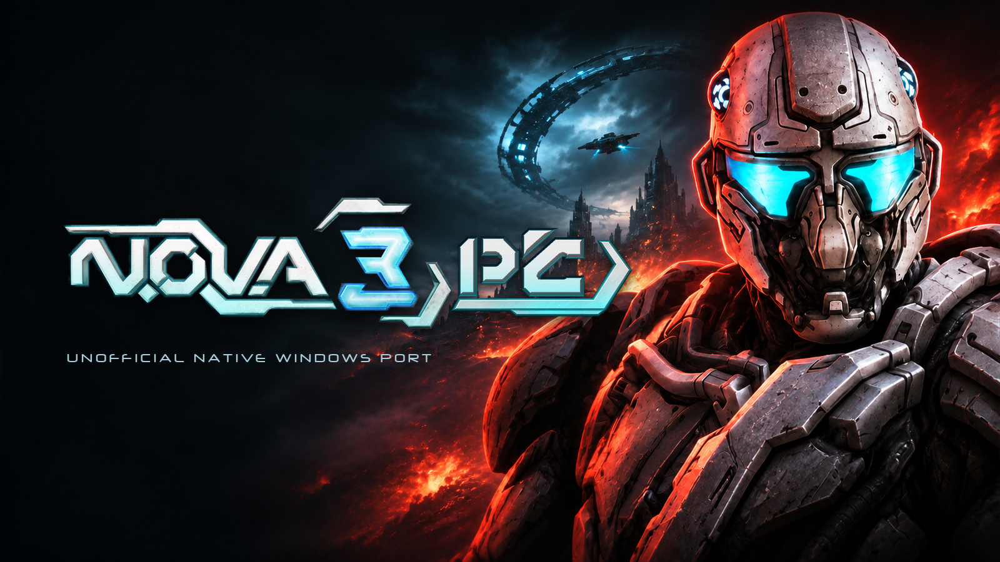

  

  <b>Play N.O.V.A. 3 natively on Windows, with keyboard and mouse.</b> 
  Unofficial PC port of Gameloft's <i>N.O.V.A. 3 – Near Orbit Vanguard Alliance</i> (Android 1.0.7).

  
  
  
  

---

## What it is

N.O.V.A. 3 PC runs the game's original Android **x86** library directly inside a
32-bit Windows process: no emulator, no virtual machine, no CPU translation.
Graphics go through ANGLE (Direct3D 11), audio through SDL3, and the game's own
menus and controls are driven by native PC input.

**You need your own copy of the game.** This project ships no game files. On
first start the launcher asks for your original APK, verifies it, and prepares
everything locally.

## Highlights

- **One-click start** – a guided first-run launcher: drag your APK onto the
  window, wait for the progress bar, play. Later starts open the game directly.
- **Real PC controls** – mouse look, WASD, remappable keys, sprint, grenades,
  vehicles and mechs. Gamepad support is experimental.
- **Modern display options** – resizable window, borderless fullscreen
  (Alt+Enter), field-of-view controls, higher detail distance, anisotropic
  filtering and HD interface artwork.
- **Faithful** – the original game logic, campaign and multiplayer protocol
  are untouched; your saves and settings are preserved.
- **Private by design** – everything stays on your PC; Gameloft servers are
  blocked by default.
- **Six launcher languages** – English, Italiano, Français, Deutsch, Español,
  Português. Picked from Windows, switchable in the launcher's corner.

## Quick start

1. Download the latest ZIP from [Releases](https://github.com/pierluigizagaria/N.O.V.A.3-PC/releases/latest)
   and extract it anywhere (a USB drive works).
2. Run **`NOVA3.exe`**.
3. Drag your **N.O.V.A. 3 1.0.7 x86 APK** onto the window, or press
   **Select APK**. If the game data (main/patch OBB) is not next to the APK,
   the launcher asks for the data ZIP or one of the OBB files.
4. Files are verified and extracted into the `local` folder. The game then
   starts by itself – and every later start goes straight into the game.

| File | What it does |
|---|---|
| `NOVA3.exe` | **Start here.** Launcher: first-run setup, then starts the game. |
| `NOVA3-Game.exe` | The game itself, started by the launcher (double-clicking it opens the launcher). |
| `local\` | Your imported game data, settings, saves and logs. Keep it when updating. |

## Community multiplayer

Community multiplayer uses an independently operated dedicated server and is
under active development. Use the connection details supplied by your server
operator. Game files are imported locally; official Gameloft services remain
blocked by default.

## Legal

N.O.V.A. 3 and its logo are trademarks of Gameloft. This is an unofficial,
non-commercial fan project, not affiliated with or endorsed by Gameloft.
The repository contains original source code, build manifests and approved
branding artwork. Game binaries and data are not distributed. You must own the game.
